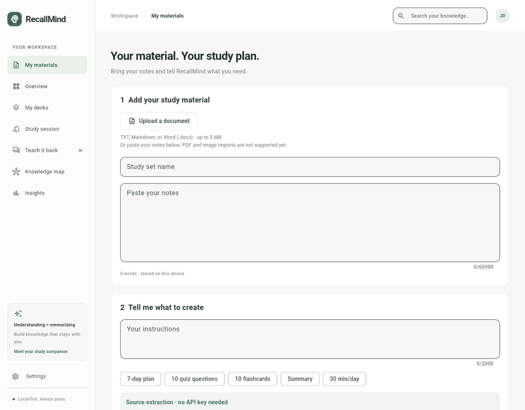
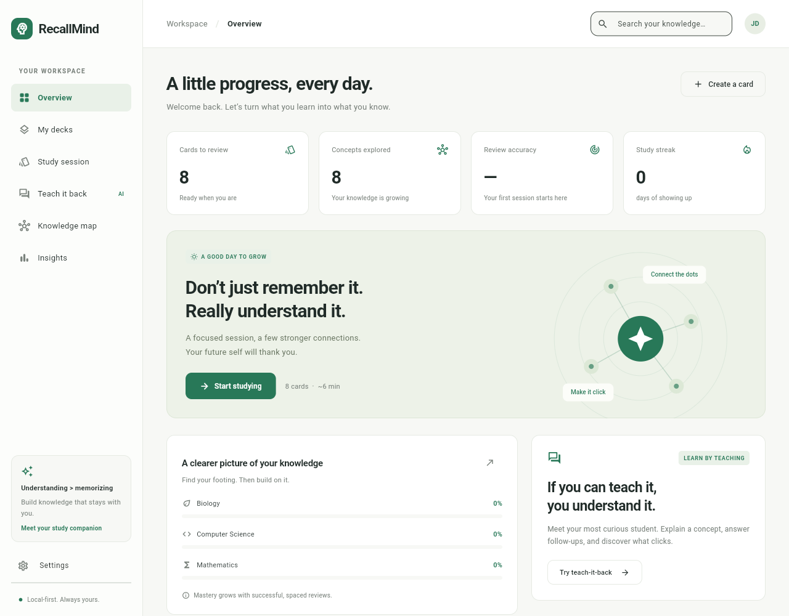
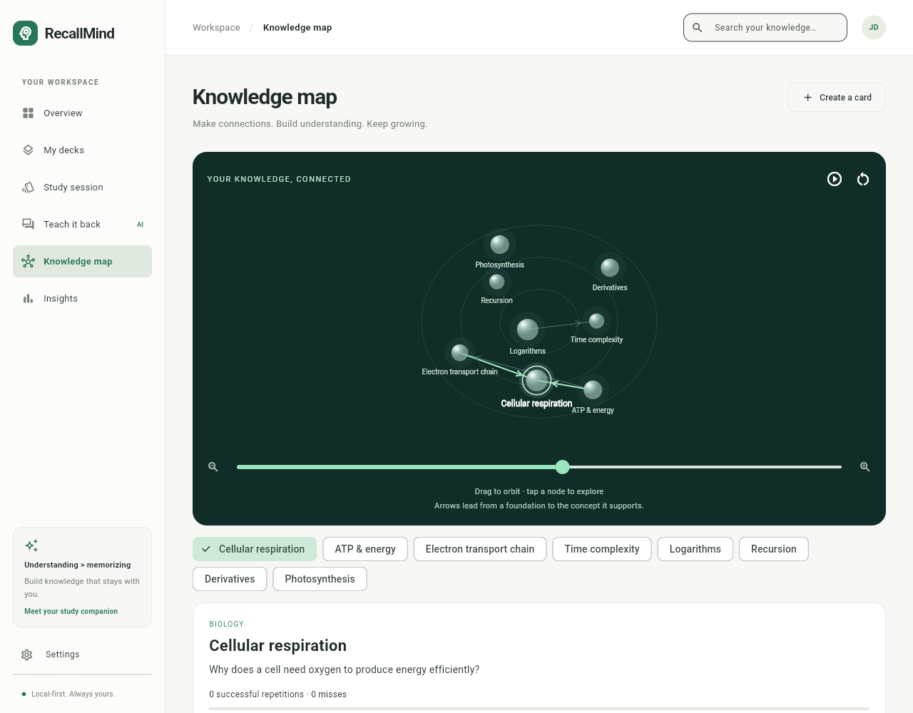
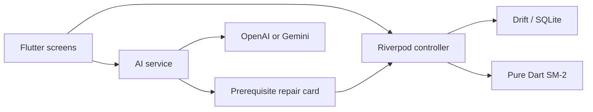

# RecallMind

A Flutter study companion that finds missing foundations and checks understanding through conversation.

[](https://flutter.dev)
[](https://asuwathkumaresh07-cyber.github.io/recallmind/)

**[Open the live app →](https://asuwathkumaresh07-cyber.github.io/recallmind/)**

## See it in motion



An actual recording of the Flutter app. Open **Knowledge map** to orbit your concepts in 3D, zoom, select a node, and practice its card. Arrows show how foundations support other concepts. The graph uses your real library and review progress.

GitHub READMEs display animated GIFs; the live app above provides the interactive version.

<details>
<summary>Explore the interface</summary>

| Study dashboard | Interactive knowledge map |
| --- | --- |
|  |  |

</details>

## Run

Requires Flutter 3.47 / Dart 3.13 or compatible newer versions.

```sh
flutter pub get
flutter run -d chrome
flutter analyze
flutter test
flutter build web --no-web-resources-cdn
```

For Android, connect a device or emulator and use `flutter run`. Windows builds require Visual Studio's Flutter prerequisites and Developer Mode for plugin symlinks. Serve `build/web` over localhost or HTTPS; do not open the HTML file directly. The web build bundles SQLite WebAssembly, a Drift worker, CanvasKit, and licensed Roboto fonts. Clearing browser storage clears the library; private browsing and storage eviction can affect persistence.

In this restricted workspace, the SDK and package cache are copied into ignored local folders. `tool/flutter-local.ps1` runs that SDK, and `tool/test-local.ps1` temporarily selects Windows' system SQLite for offline tests. Standard development should use the commands above.

If PowerShell blocks local scripts, run them with a process-local policy: `powershell -NoProfile -ExecutionPolicy Bypass -File tool/test-local.ps1`.

## Web deployment

The live app is served by GitHub Pages from the `gh-pages` branch. Source code lives on `main`. To publish an update, build with the repository base path and publish the contents of `build/web` to `gh-pages`:

```sh
flutter build web --no-web-resources-cdn --base-href /recallmind/
```

Keep a `.nojekyll` file at the deployment branch root. The build includes the SQLite worker, WebAssembly, fonts, and CanvasKit needed by the app. Updating `main` alone does not redeploy the compiled app.

The README animation is a real browser capture, stored at `docs/images/recallmind-demo.gif`. `tool/record-demo.cjs` records the locally served app with Playwright and Chrome; `tool/make-demo-gif.py` encodes the frames with Pillow. The recorder uses this workspace's Playwright installation path; adjust it for another machine.

## Features

- Responsive dashboard, searchable decks, card creation with prerequisite links, knowledge map, review history, streak, and mastery indicators.
- Hand-coded SM-2. Again / Hard / Got it / Easy map to quality 1 / 3 / 4 / 5. Successful reviews use 1 day, 6 days, then the previous interval times ease. Ease stays above 1.3. Failure resets repetitions and schedules a 1-day review; the active session retries it too.
- Swipe left after revealing an explanation to revisit, or right to mark understood. Buttons offer the same actions.
- After two misses on a card with prerequisites, graph traversal collects prerequisite performance. Live AI proposes a root gap and writes a simpler repair card. The review, schedule, and repair card commit in one SQLite transaction. The repair enters the queue before the original retry.
- Teach-it-back uses text explanations and conversational follow-ups. Live AI roleplays a confused student. Mastery requires at least three learner turns, an AI mastery judgment, and a score of 75 or more. A passed conversation records one successful review.
- AI-assisted card drafts stay editable before saving.
- Insights ranks weak concepts using actual misses/repetitions and charts seven days of reviews with fl_chart. New users start at zero; no activity is fabricated.

## AI setup and limits

Open **Settings**, choose OpenAI or Gemini, enter a model available to your account and an API key. Keys stay in memory and are cleared on restart. Live mode sends relevant concept, prerequisite performance, or conversation data to the selected provider.

OpenAI uses the [Responses API](https://developers.openai.com/api/docs/quickstart), JSON output, and `store: false`. Gemini uses [generateContent](https://ai.google.dev/api/generate-content) with JSON MIME configuration. Results are validated and requests time out after 40 seconds. No live provider request was exercised here: no key was provided and outbound access is restricted.

Without a key, **OFFLINE DEMO** is visible. Diagnosis uses a deterministic prerequisite ranking and an existing simpler question. Conversation offers a simple text-grounded practice prompt and **never awards mastery**. It is not an offline language model. Voice transcription is not included; teach-it-back currently uses text.

For a distributed production app, move provider calls behind an authenticated backend with server-side credentials, rate limits, and observability. This is a local, bring-your-own-key prototype. Native Android/Windows release builds and live API calls need target-environment validation.

## Interview guide

### 30-second pitch

“RecallMind is a Flutter study app that asks why a learner keeps missing a card. It checks prerequisite performance, generates a simpler repair card, and returns to the original question. Learners also teach a concept to an AI student who asks follow-ups. Riverpod coordinates state, Drift keeps reviews local, and a hand-coded SM-2 algorithm schedules the next review.”

### Architecture



| File | Responsibility |
| --- | --- |
| `lib/domain.dart` | Card model, JSON, pure SM-2, starter concepts |
| `lib/database.dart` | Explicit SQL schema, migrations, atomic writes, persistence |
| `lib/state.dart` | Riverpod dependencies and state updates after successful writes |
| `lib/ai_service.dart` | Provider adapters, prerequisite traversal, diagnosis, roleplay, demo |
| `lib/main.dart` | Responsive dashboard, theme, deck editor, insights |
| `lib/study_screen.dart` | Review queue, swipes, repair insertion, conversation |

Two SQL tables separate current card state from the append-only review log. Cards contain a small JSON payload; reviews remain queryable SQL rows. Drift uses explicit SQL and migrations without code generation. A larger version should normalize deck/concept IDs and prerequisite edges, and split screen components into feature folders.

### Three-minute demo

1. Show the dashboard and open Biology.
2. Mark cellular respiration **Again**, answer the other cards, then mark respiration **Again** on its retry.
3. Show the prerequisite explanation and choose **Rebuild & retry**. Answer the simpler card, then retry respiration.
4. Open **Teach it back** and explain a concept. With a live key, handle at least three follow-ups. Without a key, explain the practice-demo limitation.
5. Show Insights and reload to demonstrate persistent reviews and schedules.

### Questions to prepare

**How is this different from a normal queue?** A prerequisite relationship changes what the learner studies. Rescheduling alone does not introduce the missing foundation.

**Is diagnosis certain?** No. It is a hypothesis constrained to known prerequisites and available performance evidence. The learner tests it by rebuilding the foundation and retrying.

**How do you constrain hallucinations?** Accept a root only if it belongs to the traversed prerequisite graph, validate required output fields, and reject unrelated selections. Generated explanations still need educational evaluation.

**What does mastery mean?** Dashboard mastery is a heuristic: consecutive successful repetitions divided by five, capped at 100%, averaged per deck. Conversational mastery uses a separate AI rubric and minimum follow-up evidence. Neither is a scientifically validated learning measurement.

**What happens on an AI failure?** The error stays visible and retryable. Diagnosis completes before committing the review, preventing duplicate review records when retrying an API failure.

**Why Riverpod and Drift?** Riverpod separates asynchronous state from widgets and supports test overrides. Drift supplies SQLite transactions and cross-platform persistence. SM-2 remains pure Dart and independently testable.

**What next?** Backend credentials and usage limits, stable concept IDs, speech transcription, AI evaluation datasets, confidence calibration, and broader device/accessibility checks. Avoid claiming that no competitor offers similar features without market research.

## Design and validation

Warm off-white, charcoal, and emerald follow a restrained three-color / 60–30–10 approach. Typography references the supplied [Jenkins repository](https://github.com/jenkinsci/jenkins): its [theme stylesheet](https://github.com/jenkinsci/jenkins/blob/master/src/main/scss/abstracts/_theme.scss) specifies a system sans-serif stack including Roboto. RecallMind bundles licensed Roboto regular, medium, and bold for consistent offline rendering in Flutter. Short card fades and responsive layouts keep interactions calm.

Tests cover SM-2 intervals/failures/minimum ease, serialization, prerequisite selection, offline mastery limits, SQLite persistence, desktop/mobile layout, and the two-miss repair sequence. Browser checks capture the web release at desktop and phone sizes.
